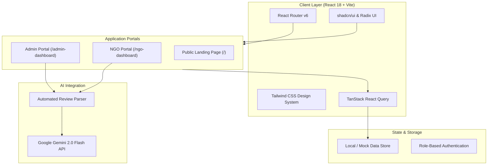

# 🌱 Vruksh Ekatra — Educational Ecosystem for Under-Served Communities

[](https://www.jpmorganchase.com/)
[](#team-50-members)
[](https://react.dev/)
[](https://www.typescriptlang.org/)
[](https://vitejs.dev/)
[](https://tailwindcss.com/)
[](https://aistudio.google.com/)

---

## 📖 Table of Contents
- [About the Project](#-about-the-project)
- [The Challenge](#-the-challenge)
- [Our Solution](#-our-solution)
- [Key Features](#-key-features)
- [System Architecture](#-system-architecture)
- [Tech Stack](#-tech-stack)
- [Directory Structure](#-directory-structure)
- [Getting Started](#-getting-started)
- [Environment Variables](#-environment-variables)
- [Team 50 Members](#-team-50-members)
- [Acknowledgments](#-acknowledgments)

---

## 📌 About the Project

**Vruksh Ekatra** is an integrated educational platform engineered during the **JPMorgan Chase Code for Good (CFG) Hackathon 2025 (Mumbai)** by **Team 50**, tailored specifically for the **Vruksh Ecosystem** initiative.

Millions of learners in under-served and remote communities face severe obstacles to quality education: unreliable internet connections, lack of high-end digital devices, and fragmented educational content. **Vruksh Ekatra** bridges this divide by enabling NGOs to author modular, bite-sized learning courses and deploy them via low-bandwidth channels (such as WhatsApp) while leveraging **Google Gemini AI** to automatically review, critique, and ensure the pedagogical quality of every curriculum submission before release.

---

## 🎯 The Challenge

1. **Connectivity Barriers**: Learners in rural and low-income areas often lack continuous high-speed broadband, making heavy video platforms inaccessible.
2. **Resource & Standardization Bottlenecks**: Non-profit organizations frequently lack instructional design experts to review whether curricula meet foundational learning standards.
3. **Fragmented Governance**: Administrators lack centralized oversight to evaluate educational materials, coordinate multiple NGO contributors, and monitor student uptake.

---

## 💡 Our Solution


- **Dual Dedicated Portals**:
  - **NGO Portal**: Streamlined course builder, draft management, module planning, and student tracking.
  - **Admin Governance Hub**: Course approval pipeline, organization management, platform-wide analytics, and AI audit logs.
- **Automated AI Course Quality Review**: Instant pedagogical evaluation powered by Google Gemini, generating quantifiable scores and actionable recommendations.
- **Micro-Learning Architecture**: Course content is divided into bite-sized modules suitable for low-bandwidth distribution.

---

## ✨ Key Features

### 🤖 1. AI-Powered Course Review Automation (Google Gemini 2.0 Flash)
- **Deep Curriculum Analysis**: Evaluates submitted course titles, descriptions, and module plans against educational benchmarks.
- **Multi-Dimensional Scoring (0-100)**:
  - *Content Quality & Clarity*
  - *Learning Objective Alignment*
  - *Target Audience Suitability & Prerequisites*
  - *Comprehensiveness & Practical Value*
- **Actionable Feedback**: Generates automated suggestions for content refinement, pacing improvements, and recommended supplemental resources.

### 📚 2. NGO Course Studio & Management
- **Modular Curriculum Builder**: Build courses module by module with learning outcomes, duration, and target demographics.
- **Request Submission**: Submit new courses for administrative review with one-click status tracking (`Pending`, `Under Review`, `Approved`, `Rejected`).
- **Interactive Dashboards**: NGO administrators can track module completions and student engagement.

### 🛡️ 3. Admin Governance & Approval Center
- **Request Inspection**: Inspect pending course submissions along with the automated Gemini AI assessment report.
- **Feedback & Decision**: Approve or reject courses with contextual notes directly communicated back to the submitting NGO.
- **Partner & User Management**: Manage registered NGOs, active students, and overall platform metrics.

### 📊 4. Real-Time Analytics
- Dynamic charts displaying student registrations, active courses, completion trends, and NGO participation statistics using **Recharts**.

---

## 🏗️ System Architecture



---

## 🛠️ Tech Stack

| Category | Technologies |
|---|---|
| **Frontend Framework** | [React 18](https://react.dev/) with [TypeScript](https://www.typescriptlang.org/) |
| **Build Tool** | [Vite 5](https://vitejs.dev/) with SWC |
| **Styling & Components** | [Tailwind CSS](https://tailwindcss.com/), [shadcn/ui](https://ui.shadcn.com/), [Radix UI](https://www.radix-ui.com/), [Lucide React](https://lucide.dev/) |
| **Data Fetching & State** | [TanStack React Query v5](https://tanstack.com/query/latest), [Axios](https://axios-http.com/) |
| **Forms & Validation** | [React Hook Form](https://react-hook-form.com/), [Zod](https://zod.dev/) |
| **Visualizations** | [Recharts](https://recharts.org/) |
| **Artificial Intelligence** | [Google Gemini 2.0 Flash](https://ai.google.dev/) via REST API |

---

## 📁 Directory Structure

```text
CFG-Vruksh-EcoSystem/
├── Frontend/
│   ├── public/                 # Static assets (favicons, manifest, robots.txt)
│   ├── src/
│   │   ├── components/         # Reusable UI components & dialogs
│   │   │   ├── ui/             # shadcn/ui primitive components (Button, Dialog, Card...)
│   │   │   ├── AppSidebar.tsx  # Admin navigation sidebar
│   │   │   ├── Sidebar.tsx     # NGO navigation sidebar
│   │   │   ├── RequestReviewModal.tsx # Admin approval modal
│   │   │   ├── ReviewModal.tsx # AI Gemini review results modal
│   │   │   └── ...
│   │   ├── constants/          # System prompts & static configurations
│   │   │   └── Constants.ts    # Gemini AI review prompt & schema
│   │   ├── hooks/              # Custom React hooks (use-mobile, use-toast)
│   │   ├── lib/                # Utility functions (cn / clsx helper)
│   │   ├── pages/              # Route views
│   │   │   ├── AdminDashboard.tsx
│   │   │   ├── AdminAnalytics.tsx
│   │   │   ├── AdminRequests.tsx
│   │   │   ├── Dashboard.tsx    # NGO dashboard
│   │   │   ├── Courses.tsx      # Course catalog
│   │   │   ├── NewCourse.tsx    # Course authoring form
│   │   │   ├── CourseDetail.tsx # Detailed course view
│   │   │   ├── Auth.tsx         # Login & registration entry
│   │   │   └── Index.tsx        # Public landing page
│   │   ├── service/            # API & external service integrations
│   │   │   └── AiModel.ts      # Google Gemini API connector
│   │   ├── App.tsx             # Root router & layout configuration
│   │   ├── main.tsx            # React application entry point
│   │   └── index.css           # Global Tailwind CSS definitions
│   ├── .env.example            # Environment variables template
│   ├── components.json         # shadcn/ui configuration
│   ├── package.json            # Frontend dependencies & scripts
│   ├── tailwind.config.ts      # Custom Tailwind palette & animations
│   ├── tsconfig.json           # TypeScript configuration
│   └── vite.config.ts          # Vite build configuration
├── .gitignore                  # Git ignore rules
└── README.md                   # Project documentation
```

---

## 🚀 Getting Started

### Prerequisites
- [Node.js](https://nodejs.org/) (version `18.x` or higher recommended)
- `npm`, `yarn`, or `pnpm`

### Installation

1. **Clone the repository**:
   ```bash
   git clone https://github.com/Hiren1604/CFG-Vruksh-EcoSystem.git
   cd CFG-Vruksh-EcoSystem
   ```

2. **Navigate to the Frontend directory**:
   ```bash
   cd Frontend
   ```

3. **Install dependencies**:
   ```bash
   npm install
   ```

4. **Configure environment variables**:
   Create a `.env` file in the `Frontend/` directory:
   ```bash
   cp .env.example .env
   ```
   Open `.env` and add your Google Gemini API key:
   ```env
   VITE_GEMINI_API_KEY=your_gemini_api_key_here
   ```

5. **Start the development server**:
   ```bash
   npm run dev
   ```
   Open [http://localhost:5173](http://localhost:5173) in your browser to explore the platform.

6. **Build for production**:
   ```bash
   npm run build
   ```

---

## 🔑 Environment Variables

| Variable | Description | Required |
|---|---|---|
| `VITE_GEMINI_API_KEY` | Google Gemini API key used for automated course review analysis | Yes |

> Obtain a key for free via the [Google AI Studio Console](https://aistudio.google.com/).

---

## 👥 Team 50 Members

Built with passion and teamwork during **JPMorgan Chase Code for Good 2025 (Mumbai)**:

- **Hiren Waghela** ([@hiren1604](https://github.com/hiren1604))
- **Siya Nair** ([@Siyanair22](https://github.com/Siyanair22))
- **Muskan**
- **Adriteyo**
- **Sahil Kumar**

---

## 🏆 Acknowledgments

- **JPMorgan Chase & Co.** for organizing the Code for Good (CFG) Mumbai 2025 Hackathon.
- **Vruksh Ecosystem** for presenting the inspiring challenge of bringing accessible education to under-served communities.
- Mentors and advisors who guided Team 50 during the event.